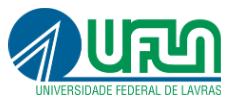
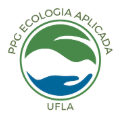
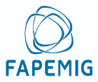

# Instituições vinculadas à Vitrine Ciência

As instituições vinculadas ao projeto são representadas pelos três logos fornecidos pelo responsável pela Vitrine Ciência em 12 de outubro de 2026.

 &nbsp;  &nbsp; 

- Universidade Federal de Lavras — UFLA.
- Programa de Pós-Graduação em Ecologia Aplicada da UFLA.
- FAPEMIG.

## Aplicação

Os logos aparecem no rodapé das páginas públicas, incluindo as 58 fichas individuais, e na documentação do projeto. O rótulo adotado é “Instituições vinculadas ao projeto”.

As imagens foram extraídas individualmente do anexo fornecido, sem redesenho, alteração de cores ou distorção de proporções. A aplicação mantém fundo branco, espaço ao redor e tamanho legível, inclusive em dispositivos móveis e impressão.

Os símbolos institucionais não são abrangidos pela licença MIT do código nem pela licença CC BY 4.0 dos metadados da Vitrine. Permanecem associados às instituições representadas.
